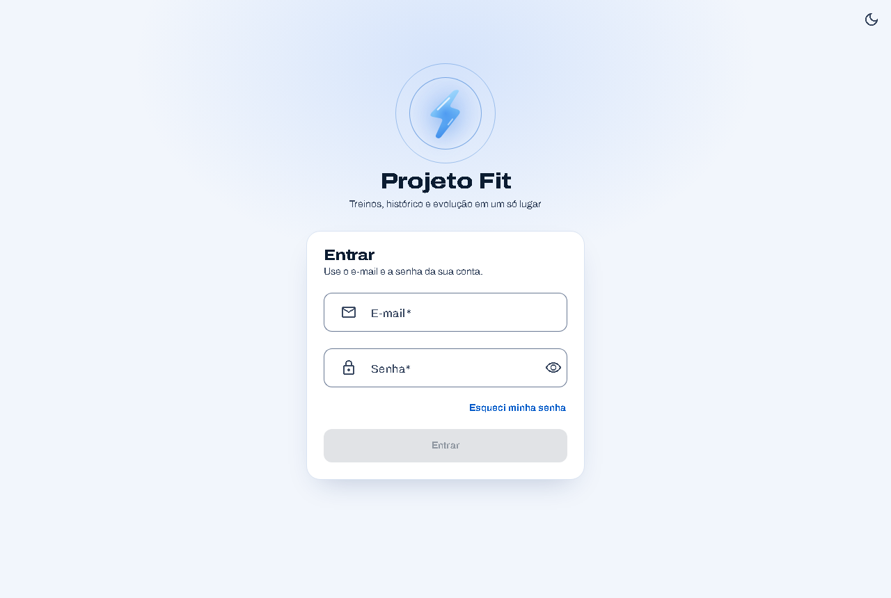
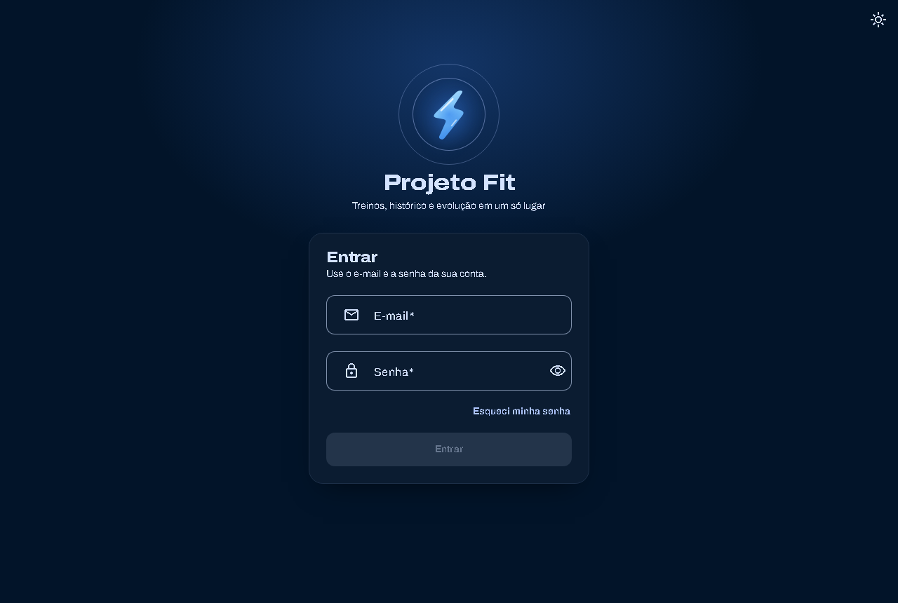

<div align="center">


# Projeto Fit

**App web para um personal trainer acompanhar os treinos e a evolução dos seus alunos.**


</div>

<p align="center">
  
  
</p>

## Sobre

O Projeto Fit dá ao personal trainer mais controle sobre seus alunos. Em um só lugar, ele monta as fichas de treino, acompanha quem está treinando e quem sumiu, e vê como as cargas e a frequência de cada aluno estão evoluindo. Do outro lado, o aluno segue a ficha e registra o treino no celular durante a sessão, mesmo com a internet da academia oscilando, e tudo chega ao personal.

A interface é em português, pensada primeiro para o celular, e tem modo claro e escuro.

## Funcionalidades

**Para o personal**

- Dashboard com todos os alunos: treinos feitos na semana, último treino e alertas de quem sumiu ou está com a ficha vencida.
- Cadastro de alunos com convite por e-mail; o aluno define a própria senha.
- Catálogo de exercícios por grupo muscular, com link de vídeo opcional.
- Fichas de treino com divisões (A, B, C…), séries, repetições, carga e descanso prescritos.
- Desempenho de cada aluno: aderência semanal à ficha e evolução de carga e volume por exercício.
- Histórico de treinos de cada aluno, com as séries, cargas e repetições registradas.

**Para o aluno**

- Treino do dia com a próxima divisão sugerida.
- Registro de carga e repetições série a série, salvo no aparelho: o treino não se perde se a conexão cair e é enviado quando ela voltar.
- Histórico dos próprios treinos e gráficos da própria evolução.

## Destaques técnicos

- **API em camadas por funcionalidade** (`aluno`, `exercicio`, `ficha`, `sessao`, `desempenho`…): controllers só com DTOs, regras de negócio e verificação de posse nos services.
- **Autenticação com Supabase Auth** e autorização no Spring: a API é um OAuth2 Resource Server que valida o JWT pela chave pública (JWKS), e o papel do usuário vem do banco, nunca do token.
- **Dados isolados por usuário:** toda consulta é filtrada pelo usuário autenticado; o banco tem RLS ligado sem políticas, então os dados só são acessíveis pela API.
- **Registro de treino tolerante a falhas:** fila local no navegador e envio idempotente, para que um treino reenviado nunca seja gravado duas vezes.
- **Esquema versionado com Flyway** e erros no padrão Problem Details, com mensagens em português.
- **Testes de integração com Testcontainers** (PostgreSQL real) no back e Vitest no front, rodando no GitHub Actions a cada push.
- **Tema próprio sobre o Material 3**: paleta azul gerada a partir da cor da marca e modo claro/escuro que segue o sistema ou a escolha do usuário.

## Arquitetura

```
[Celular / Desktop] ──HTTPS──> Angular (Vercel)
        │                          │
        │ login e senha            │ REST + JWT (Bearer)
        ▼                          ▼
  Supabase Auth ──JWKS──>  Spring Boot API (Render)
                                   │
                                   ▼
                        PostgreSQL (Supabase)
```

O Angular usa o Supabase só para autenticação; todos os dados passam pela API, que é a única dona das regras de negócio e a única cliente do banco.

## Estrutura do repositório

```
backend/    API Spring Boot (Java 21, Maven, Flyway)
frontend/   App Angular (standalone components, signals, Angular Material)
docs/       imagens do README
```

## Status

Em desenvolvimento. As funcionalidades da primeira versão estão prontas; a próxima etapa é o deploy (Vercel, Render e Supabase).
